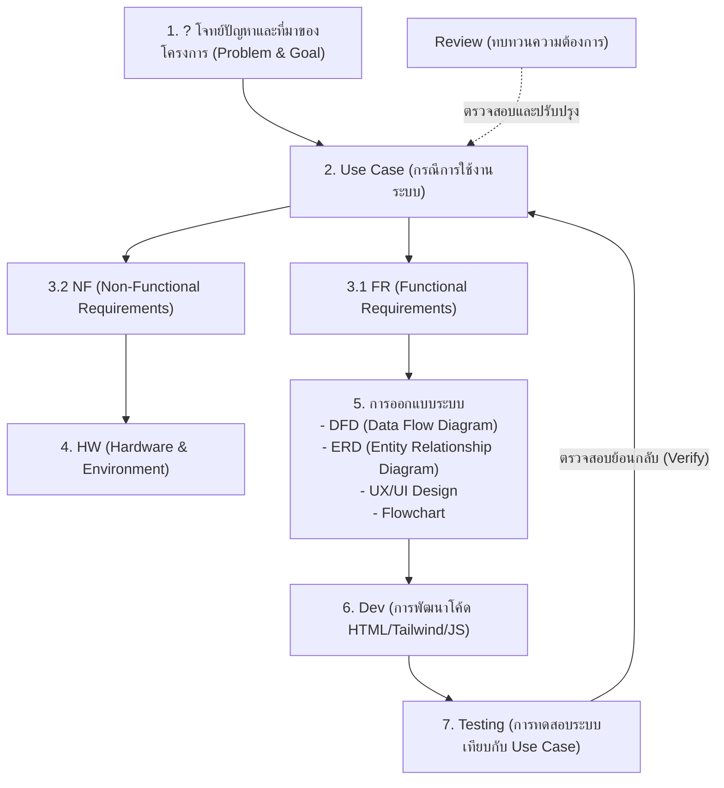
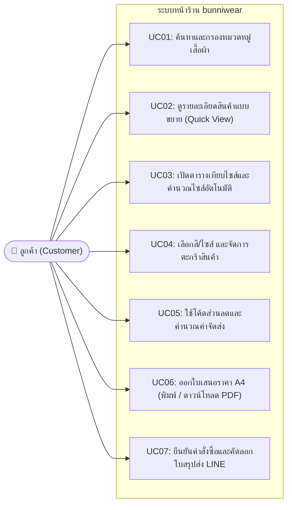
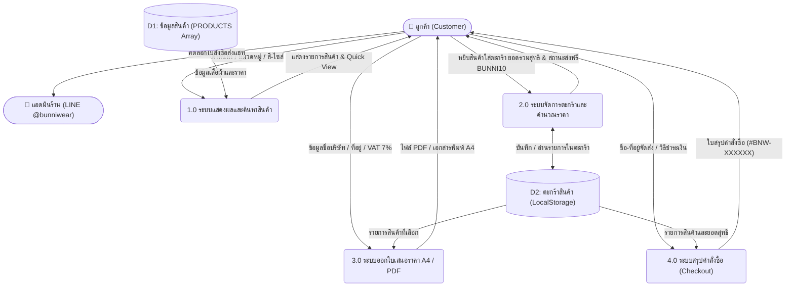
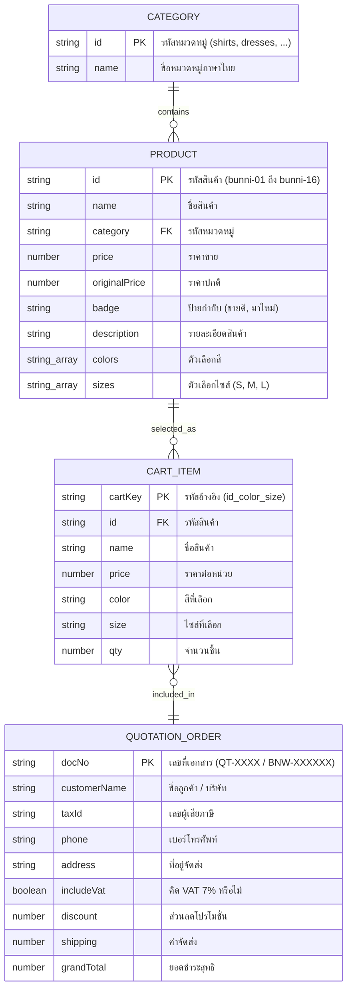
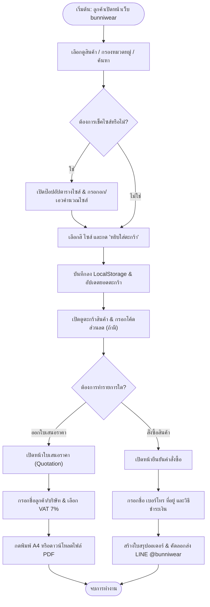

# 📘 เอกสารวิเคราะห์และออกแบบระบบ (System Analysis & Design)
## โครงการ: ระบบหน้าเว็บขายเสื้อผ้าแฟชั่นและออกใบเสนอราคาออนไลน์ (bunniwear)

เอกสารฉบับนี้จัดทำขึ้นตามโครงสร้างกระบวนการวิเคราะห์และออกแบบระบบ (System Development Life Cycle: SDLC) ที่ระบุไว้บนกระดานไวท์บอร์ด โดยประยุกต์ใช้กับโปรเจกต์ **[`bunniwear`](file:///C:/Users/chati/bunniwear/index.html)** อย่างครบถ้วนทุกขั้นตอน

---

## 🗺️ ภาพรวมโครงสร้างตามกระดานไวท์บอร์ด (Overview Workflow)

---

## 1. ❓ โจทย์ปัญหาและที่มาของโครงการ (`?` & `Review`)

### ที่มาของปัญหา (`?`)
ร้านเสื้อผ้าแฟชั่นสไตล์เกาหลี-มินิมอล **bunniwear** ต้องการมีหน้าร้านออนไลน์ที่ลูกค้าสามารถเข้าชมแคตตาล็อกสินค้า เลือกสีและไซส์ คำนวณราคาและส่วนลด สรุปคำสั่งซื้อเพื่อส่งทาง LINE และสามารถ **ออกใบเสนอราคา (Quotation) เป็นไฟล์ PDF / สั่งพิมพ์กระดาษ A4** ได้ทันที **โดยไม่ต้องการเสียค่าใช้จ่ายในการดูแลเซิร์ฟเวอร์หรือระบบหลังบ้าน (No Backend)**

### การทบทวนความต้องการ (`← Review`)
- ต้องเปิดใช้งานได้ทันทีด้วย HTML/CSS/JavaScript เพียงไฟล์เดียว ([`index.html`](file:///C:/Users/chati/bunniwear/index.html))
- ต้องจำข้อมูลตะกร้าสินค้าของลูกค้าได้แม้กดรีเฟรชหน้าเว็บ (ใช้ `LocalStorage`)
- ต้องรองรับทั้งลูกค้าซื้อปลีกทั่วไป และลูกค้าองค์กร/ขายส่งที่ต้องการใบเสนอราคา PDF

---

## 2. 👥 Use Case (กรณีการใช้งานระบบ)

ผู้ใช้งานหลักของระบบคือ **ลูกค้าผู้เข้าชมเว็บไซต์ (Customer / Buyer)** โดยมีกรณีการใช้งาน (Use Cases) ดังนี้:

---

## 3. 📋 ความต้องการของระบบ (`FR` และ `NF`)

### 3.1 `FR` — Functional Requirements (ความต้องการทางฟังก์ชัน: ระบบทำอะไรได้บ้าง)
1. **ระบบแสดงผลและค้นหาสินค้า:** แสดงรายการเสื้อผ้าทั้งหมด 16 รุ่น แยกกลุ่มตาม 4 หมวดหมู่หลักชัดเจน (`เสื้อเชิ้ต & เสื้อยืด`, `ชุดเดรส & มินิเดรส`, `กางเกง & กระโปรง`, `เสื้อคลุม & เบลเซอร์` หมวดหมู่ละ 4 รุ่น) พร้อมปุ่มดู `ทั้งหมด (16)` ช่องค้นหาชื่อสินค้า และตัวเลือกเรียงลำดับราคา
2. **ระบบ Quick View & ตัวเลือกบนการ์ด:** แสดงป๊อปอัปรายละเอียดสินค้า จุดเด่นเนื้อผ้า เลือกสี ไซส์ และปรับจำนวนชิ้นได้ทันทีทั้งบนการ์ดและในหน้าต่าง Quick View
3. **ระบบตารางไซส์และคำนวณไซส์:** รับค่ารอบอกและรอบเอว (นิ้ว) ของลูกค้า แล้วประมวลผลแนะนำไซส์ (`S`, `M`, `L`, `Free Size`) อัตโนมัติ
4. **ระบบตะกร้าสินค้าและโปรโมชั่น:** เพิ่ม/ลดจำนวนสินค้า คำนวณสิทธิ์ส่งฟรีเมื่อครบ ฿990 และคำนวณส่วนลด 10% เมื่อกรอกโค้ด `BUNNI10`
5. **ระบบออกใบเสนอราคา (Quotation & PDF):** รับข้อมูลชื่อลูกค้า/บริษัท เลขผู้เสียภาษี ที่อยู่ คำนวณ VAT 7% แปลงจำนวนเงินเป็นตัวอักษรภาษาไทย (Baht Text) และสั่งพิมพ์หรือดาวน์โหลดเป็นไฟล์ PDF ขนาด A4
6. **ระบบสรุปออเดอร์และแชท LINE:** สร้างข้อความสรุปคำสั่งซื้อพร้อมเลขที่ออเดอร์ (`#BNW-XXXXXX`) และคัดลอกส่งทาง LINE `@bunniwear`

---

### 3.2 `NF` — Non-Functional Requirements (ความต้องการที่ไม่ใช่ฟังก์ชัน: คุณภาพของระบบ)
1. **Performance (ความเร็ว):** โหลดหน้าเว็บเสร็จภายใน 1-2 วินาที การกรองหมวดหมู่และคำนวณราคาทำงานแบบ Real-time ทันทีโดยไม่ต้องโหลดหน้าใหม่
2. **Usability & Responsiveness (ความง่ายในการใช้งาน):** รองรับหน้าจอทุกขนาด (Mobile, Tablet, Desktop) ด้วย Tailwind CSS
3. **Reliability & Persistence (ความเสถียรของข้อมูล):** เก็บข้อมูลตะกร้าสินค้าไว้ใน `Browser LocalStorage` ข้อมูลไม่หายเมื่อเผลอปิดแท็บหรือรีเฟรช
4. **Portability (ความสะดวกในการติดตั้ง):** เป็นสถาปัตยกรรมแบบ Static Single-Page HTML ไม่พึ่งพาฐานข้อมูลหลังบ้าน สามารถโฮสต์บน GitHub Pages ได้ฟรี

---

## 4. 💻 `HW` — Hardware & Environment (อุปกรณ์และสภาพแวดล้อม)

สืบเนื่องจาก `NF` ที่ออกแบบให้เป็นระบบ Static Web จึงใช้ทรัพยากรเครื่องต่ำมาก:

| หมวดหมู่ | สเปกขั้นต่ำ / สภาพแวดล้อมที่รองรับ |
| :--- | :--- |
| **ฝั่งผู้ใช้งาน (Client Device)** | สมาร์ทโฟน (iOS / Android), แท็บเล็ต หรือคอมพิวเตอร์ PC / Mac ทั่วไป (RAM ขั้นต่ำ 2 GB) |
| **เว็บเบราว์เซอร์ (Browser)** | Google Chrome, Microsoft Edge, Safari, Firefox เวอร์ชันมาตรฐาน |
| **ฝั่งเครื่องนักพัฒนา (Developer PC)** | คอมพิวเตอร์ Windows / Mac ติดตั้ง VS Code, Git และ GitHub Desktop |
| **ระบบคลาวด์และโฮสติ้ง (Hosting)** | GitHub Repository (`bunniwear04-star/bunniwear`) และ GitHub Pages (ฟรี ไม่ต้องใช้เซิร์ฟเวอร์หลังบ้าน) |

---

## 5. 🎨 การออกแบบระบบ (`DFD`, `ERD`, `UX/UI`, `Flowchart`)

### 5.1 `DFD` — Data Flow Diagram (แผนภาพกระแสข้อมูล)

แสดงทิศทางการไหลของข้อมูลระหว่าง **ลูกค้า**, **กระบวนการในหน้าเว็บ**, และ **หน่วยเก็บข้อมูลในเบราว์เซอร์ (`LocalStorage`)**:

---

### 5.2 `ERD` — Entity Relationship Diagram (โครงสร้างความสัมพันธ์ของข้อมูล)

แม้ระบบจะไม่มีฐานข้อมูลหลังบ้าน แต่ภายในโค้ด JavaScript มีการจัดเก็บโครงสร้างข้อมูล (Data Model) ในหน่วยความจำและ `LocalStorage` ดังนี้:

#### 📖 คำอธิบายแผนภาพ ERD อย่างละเอียด (แบ่งเป็น 3 ส่วน)

**1) ความหมายของคำย่อและสัญลักษณ์ในตาราง (Keys & Data Types)**
- **`PK` (Primary Key - คีย์หลัก):** คือ *"รหัสประจำตัวที่ไม่ซ้ำกัน"* ของข้อมูลชุดนั้น (เปรียบเหมือนเลขบัตรประชาชน)
- **`FK` (Foreign Key - คีย์นอก):** คือ *"รหัสเชื่อมโยง"* ที่เอาไว้อ้างอิงว่าข้อมูลนี้ผูกอยู่กับตารางไหน
- **`string` / `number` / `boolean` / `string_array`:** คือชนิดของข้อมูล ได้แก่ ข้อความ (`string`), ตัวเลขราคา/จำนวน (`number`), ค่าจริง/เท็จ (`boolean`), และชุดตัวเลือกหลายค่า เช่น หลายสี/หลายไซส์ (`string_array`)

**2) ความหมายของทั้ง 4 กล่อง (4 ตารางข้อมูล) จากบนลงล่าง**
- **📦 กล่องที่ 1: `CATEGORY` (หมวดหมู่สินค้า)** — เก็บหมวดหมู่เสื้อผ้าทั้ง 4 หมวดหมู่หลักของร้าน
  - `id (PK)`: รหัสหมวดหมู่ เช่น `shirts`, `dresses`, `pants`, `outerwear`
  - `name`: ชื่อหมวดหมู่ภาษาไทย เช่น *"เสื้อเชิ้ต & เสื้อยืด"*, *"ชุดเดรส & มินิเดรส"*
- **👗 กล่องที่ 2: `PRODUCT` (ข้อมูลสินค้า)** — เก็บรายละเอียดเสื้อผ้าทั้ง 16 รุ่นในร้าน (หมวดหมู่ละ 4 รุ่น)
  - `id (PK)`: รหัสสินค้า เช่น `bunni-01` ถึง `bunni-16`
  - `name`: ชื่อสินค้า เช่น *"เสื้อเบลาส์แขนพองผ้าชีฟองลายจุด (Polka Dot Blouse)"*
  - `category (FK)`: รหัสหมวดหมู่ที่เชื่อมมาจากกล่อง `CATEGORY` ด้านบน เพื่อให้ระบบรู้ว่าเสื้อตัวนี้อยู่หมวดไหน
  - `price` / `originalPrice`: ราคาขายจริง (เช่น 350) และราคาเต็มก่อนลด (เช่น 450)
  - `colors` / `sizes`: รายการสีและไซส์ที่มีให้เลือก
- **🛒 กล่องที่ 3: `CART_ITEM` (รายการสินค้าในตะกร้า)** — เก็บรายการที่ลูกค้ากดเลือกใส่ตะกร้า (บันทึกใน `LocalStorage` ของเบราว์เซอร์)
  - `cartKey (PK)`: รหัสเฉพาะของรายการในตะกร้า เกิดจากการนำ `รหัสสินค้า + สี + ไซส์` มารวมกัน (เช่น `bunni-01_ขาวลายจุดดำ_S`) เพื่อให้ถ้าลูกค้าซื้อเสื้อรุ่นเดียวกันแต่คนละสีหรือคนละไซส์ ระบบจะแยกเป็นคนละบรรทัดได้ถูกต้อง
  - `id (FK)`: อ้างอิงรหัสสินค้าจากตาราง `PRODUCT`
  - `color` / `size` / `qty`: สีที่ลูกค้าเลือก, ไซส์ที่เลือก และจำนวนชิ้น (`qty`)
- **📄 กล่องที่ 4: `QUOTATION_ORDER` (ใบเสนอราคา / ใบสั่งซื้อ)** — เก็บข้อมูลเอกสารเมื่อลูกค้ากดออกใบเสนอราคา PDF หรือกดยืนยันคำสั่งซื้อ
  - `docNo (PK)`: เลขที่ใบเสนอราคา (`QT-2026-XXXX`) หรือเลขที่ออเดอร์ (`BNW-XXXXXX`)
  - `customerName` / `taxId` / `phone` / `address`: ชื่อลูกค้าหรือบริษัท, เลขผู้เสียภาษี, เบอร์โทร และที่อยู่จัดส่ง
  - `includeVat`: เลือกคิดภาษี VAT 7% หรือไม่ (`true` / `false`)
  - `grandTotal`: ยอดเงินรวมสุทธิที่ต้องชำระ

**3) ความหมายของเส้นเชื่อม (สัญลักษณ์ขากา / Crow's Foot Notation)**
สัญลักษณ์ **ขีดตรง 2 ขีด (`||`)** แปลว่า **"หนึ่ง (1)"** และ **วงกลมกับสามแฉกคล้ายขากา (`o{`)** แปลว่า **"ศูนย์หรือหลายรายการ (0..Many)"**:
1. **`CATEGORY` ── contains ──> `PRODUCT` (1 ต่อ หลายรายการ):** 1 หมวดหมู่ สามารถมีสินค้าได้หลายชิ้น
2. **`PRODUCT` ── selected_as ──> `CART_ITEM` (1 ต่อ หลายรายการ):** สินค้า 1 รุ่น สามารถถูกเลือกใส่ตะกร้าได้หลายรายการ (เช่น เลือกเสื้อรุ่นเดียวกันทั้งสีขาวไซส์ S และสีเบจไซส์ M)
3. **`CART_ITEM` ── included_in ──> `QUOTATION_ORDER` (หลายรายการ ต่อ 1):** สินค้าในตะกร้าหลายรายการ ถูกรวบรวมเข้าไปอยู่ในใบเสนอราคา (หรือใบสั่งซื้อ) 1 ใบ

---

### 5.3 `UX/UI` — การออกแบบประสบการณ์และส่วนติดต่อผู้ใช้
- **Concept & Mood:** สไตล์ *Seoul Minimal Studio* ใช้โทนสีครีมพาสเทล (`#fdf8f6`), สีพีช-โรสโกลด์ (`#da7b5b`) และสีดำเทาเข้ม (`#1c1917`) ให้ความรู้สึกอบอุ่น น่ารัก และดูพรีเมียม
- **Typography:** ใช้ฟอนต์ `Playfair Display` สำหรับโลโก้แบรนด์ `bunniwear` และฟอนต์ `Prompt` สำหรับภาษาไทยให้อ่านง่ายสบายตา
- **Key UI Components:**
  1. **Sticky Glass Navbar:** แถบเมนูด้านบนแบบโปร่งแสง มีปุ่มลัดเปิดตารางไซส์ ใบเสนอราคา และตะกร้าสินค้าได้ตลอดเวลา
  2. **Interactive Product Cards:** เลือกสีและไซส์ได้ทันทีบนการ์ดโดยไม่ต้องเปลี่ยนหน้า
  3. **Print-Ready A4 Layout (`@media print`):** ออกแบบหน้าต่างใบเสนอราคาให้ซ่อนปุ่มควบคุมทั้งหมดอัตโนมัติเวลาสั่งพิมพ์ เหลือเฉพาะหน้ากระดาษ A4 ที่สวยงามเหมือนเอกสารบัญชีมาตรฐาน

---

### 5.4 `Flowchart` — ผังงานการทำงานของระบบ

---

## 6. 🛠️ `Dev` — การพัฒนาโปรแกรม (Development)

- **โครงสร้างไฟล์หลัก:** พัฒนาในไฟล์ [`index.html`](file:///C:/Users/chati/bunniwear/index.html) เพียงไฟล์เดียวเพื่อให้ง่ายต่อการดูแลรักษา
- **เทคโนโลยีและไลบรารีที่ใช้ (ผ่าน CDN):**
  - **HTML5 & JavaScript (ES6+):** จัดการ State ตะกร้าสินค้า การกรองสินค้า คำนวณภาษี/ส่วนลด และแปลงตัวเลขเป็นคำอ่านภาษาไทย (`numberToThaiBahtText`)
  - **Tailwind CSS CDN:** จัดการระบบ Grid, Responsive Design และ `@media print`
  - **Lucide Icons:** ไอคอนสไตล์มินิมอลคมชัด
  - **html2pdf.js:** แปลงองค์ประกอบใบเสนอราคา (`#quotationPaper`) เป็นไฟล์เอกสาร `.pdf` ขนาด A4 ให้ดาวน์โหลดได้ในคลิกเดียว
- **ระบบควบคุมเวอร์ชัน (Version Control):** ใช้ **Git & GitHub** ([`bunniwear04-star/bunniwear`](https://github.com/bunniwear04-star/bunniwear)) เชื่อมต่อด้วย SSH Key เพื่อซิงค์โค้ดระหว่างคอมพิวเตอร์ที่บ้านและที่ทำงาน

---

## 7. ✅ `Testing` — การทดสอบระบบ (และตรวจสอบย้อนกลับไปที่ `Use Case`)

ขั้นตอนสุดท้ายคือการนำระบบที่พัฒนาเสร็จแล้ว (`Dev`) มาทดสอบเทียบกับ `Use Case` ที่ตั้งไว้ในตอนต้น (ตามเส้นลูกศรโยงกลับไปที่ `Use Case` บนกระดานไวท์บอร์ด):

| รหัสทดสอบ | Use Case ที่ทดสอบ | วิธีการทดสอบ (Test Steps) | ผลลัพธ์ที่ได้ (Actual Result) | สถานะ |
| :--- | :--- | :--- | :--- | :---: |
| **TC01** | UC01: ค้นหาและกรองสินค้า | คลิกหมวดหมู่ "ชุดเดรส" และพิมพ์ค้นหาคำว่า "ลินิน" | แสดงสินค้าตรงตามหมวดหมู่และคำค้นหาทันที | ✅ ผ่าน |
| **TC02** | UC02: ดูรายละเอียด (Quick View) | คลิกที่รูปสินค้าเพื่อเปิดหน้าต่างขยาย | แสดงภาพใหญ่ จุดเด่นสินค้า เลือกสี/ไซส์/จำนวนได้ครบ | ✅ ผ่าน |
| **TC03** | UC03: ตารางไซส์ & คำนวณไซส์ | กรอกรอบอก `33` นิ้ว รอบเอว `26` นิ้ว แล้วกดคำนวณ | ระบบแนะนำ `Size S` และ `Free Size` อย่างถูกต้อง | ✅ ผ่าน |
| **TC04** | UC04 & UC05: ตะกร้า & ส่วนลด | เพิ่มสินค้าในตะกร้า ใส่โค้ด `BUNNI10` และรีเฟรชหน้าเว็บ | ลดราคา 10% คำนวณค่าส่งถูกต้อง และข้อมูลไม่หายหลังรีเฟรช | ✅ ผ่าน |
| **TC05** | UC06: ใบเสนอราคา PDF / Print | เปิดหน้าใบเสนอราคา กรอกชื่อบริษัท ติ๊ก VAT 7% แล้วกดดาวน์โหลด PDF | ได้ไฟล์ `Quotation-QT-2026-XXXX.pdf` ขนาด A4 พร้อมคำอ่านภาษาไทยถูกต้อง | ✅ ผ่าน |
| **TC06** | UC07: สรุปออเดอร์ & แชท LINE | กรอกที่อยู่จัดส่ง กดยืนยันออเดอร์ และกดคัดลอกใบสั่งซื้อ | ได้ข้อความสรุปออเดอร์พร้อมส่งต่อให้แอดมินทาง LINE ทันที | ✅ ผ่าน |
